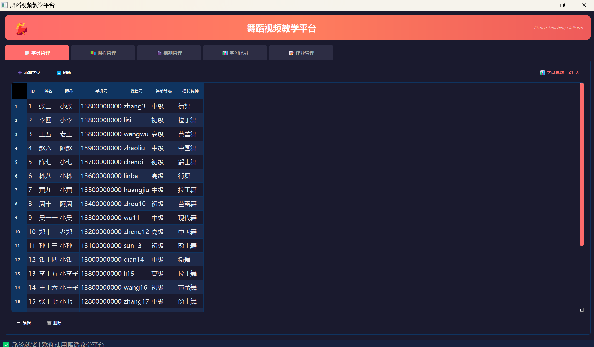
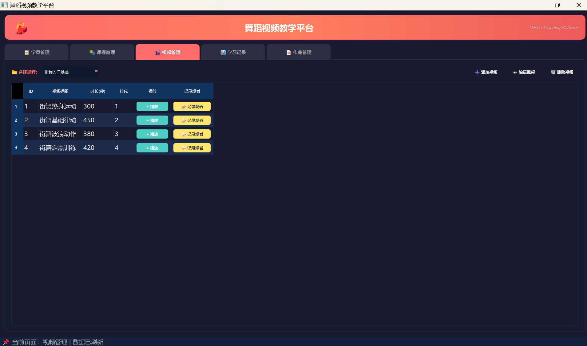
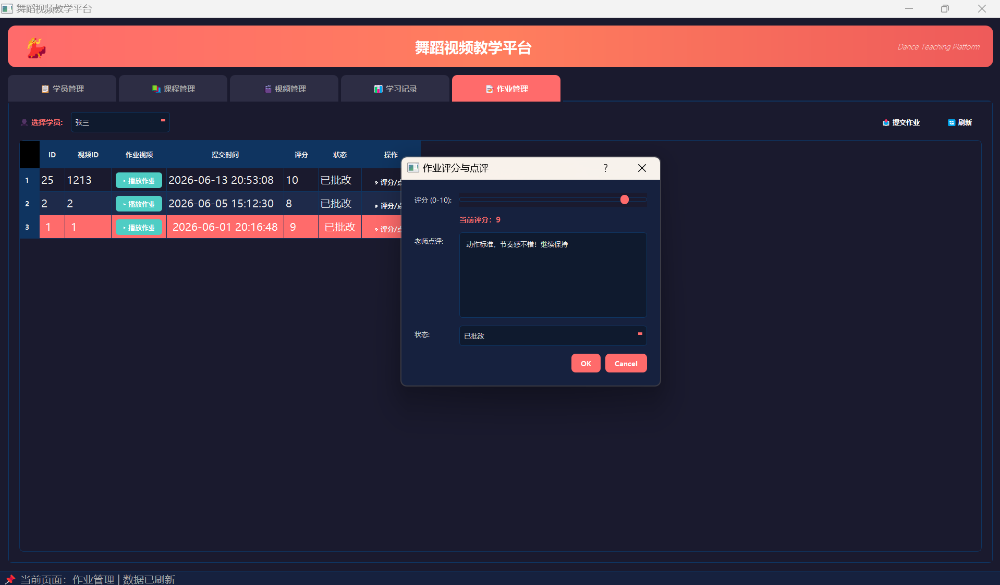

# 💃 舞蹈视频教学平台 (Dance Video Teaching Platform)


一个基于 Python + PyQt5 开发的桌面端舞蹈教学管理平台。本项目由经典的“名片管理系统”升级扩展而来，集成了学员管理、课程管理、视频教学、学习追踪和作业提交批改等核心功能，旨在帮助舞蹈培训机构实现数字化、信息化的教学管理。

## 📸 界面预览





## ✨ 功能特性

*   📋 **学员管理**：支持学员信息的增删改查（姓名、昵称、手机号、微信号、舞龄等级、擅长舞种）。
*   📚 **课程管理**：支持课程信息的增删改查（舞种、难度、价格、授课老师、简介），删除课程时支持级联删除关联视频。
*   🎬 **视频管理**：按课程分类筛选视频，支持本地视频播放与网络链接跳转，一键记录学员观看进度。
*   📊 **学习记录**：追踪指定学员的观看记录，展示已观看时长、完成状态及观看次数。
*   📝 **作业管理**：学员可提交本地视频作业，系统自动重命名防冲突；教师可在线预览、打分（0-10分）并进行文字点评。

## 🛠️ 技术栈

*   **开发语言**：Python 3.8+ (推荐 3.11)
*   **GUI 框架**：PyQt5
*   **数据库**：MySQL 8.0+
*   **数据处理与 ORM**：pandas, SQLAlchemy
*   **数据库驱动**：PyMySQL
*   **其他依赖**：shutil, webbrowser, datetime, os

## 📁 项目结构

```text
business_card/
├── res/                   # 静态资源文件夹 (datafile, img, ui)
├── .gitignore             # Git 忽略配置（保护密码、忽略视频和缓存）
├── config.example.py      # 数据库配置模板
├── dance_app.py           # 主程序入口 (包含所有界面与业务逻辑)
└── business_card.sql      # MySQL 数据库备份文件

# 说明：运行程序时会自动生成以下被 .gitignore 忽略的文件/文件夹
# ├── config.py            # 真实数据库配置（含有密码，严禁上传）
# ├── assignments_videos/  # 存放学员提交的作业视频（防空间占用/隐私泄露）
# └── venv/                # Python 虚拟环境